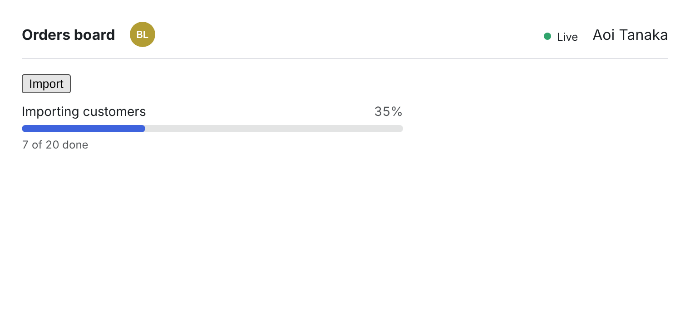

# Realtime Livewire components on Hibira

[](https://github.com/hibira-io/livewire/actions/workflows/ci.yml)

Three drop-in pieces for Livewire 3 and 4 apps on [Hibira](https://hibira.io):

- **`<x-hibira-whos-here />`**: avatars of the signed-in people on the same page, live.
- **`<livewire:hibira-batch-progress :batch="$id" />`**: a job batch's progress bar that moves as the queue works, with no `wire:poll`.
- **`<x-hibira-connection-status />`**: a dot that shows whether the realtime connection is up.



Laravel 10 to 13, PHP 8.1+.

## Install

```sh
composer require hibira-io/livewire
php artisan hibira:install
```

`hibira:install` (from [hibira-io/laravel](https://github.com/hibira-io/laravel))
sets `BROADCAST_CONNECTION=hibira` and writes `resources/js/echo.js`. Fill in
the `HIBIRA_*` values from [hibira.io/portal](https://hibira.io/portal), then
`npm install laravel-echo pusher-js` and import `./echo` in
`resources/js/app.js`. The components use `window.Echo`. Run a queue worker
for the progress bar (`php artisan queue:work`).

## Who's here

```blade
<x-hibira-whos-here />
<x-hibira-whos-here room="order-{{ $order->id }}" :max="3" />
```

By default, people on the same path meet. `room` puts everyone on any page
with that room together, such as the order page and its edit form. Your own
avatar is left out unless you pass `:self="true"`. It shows nothing to
guests.

What others see is the user's ID, `name` and `avatar` (a URL, from
`avatar_url` or Jetstream's `profile_photo_url` when the model has one).
Change it, or limit who may join a room, in a service provider:

```php
use Hibira\Livewire\HibiraLivewire;

HibiraLivewire::memberUsing(fn ($user) => ['name' => $user->nickname, 'avatar' => $user->avatar]);
HibiraLivewire::authorizeRoomsUsing(fn ($user, string $room) => $user->team_id !== null);
```

The package authorizes its presence channel
(`presence-hibira-livewire.room.{room}`) itself; `routes/channels.php` stays
as it is.

## Batch progress

```php
$batch = Bus::batch($jobs)->dispatch();
$this->batchId = $batch->id;
```

```blade
<livewire:hibira-batch-progress :batch="$batchId" label="Importing customers" :key="$batchId" />
```

After every batched job, the package sends the batch's progress to that
bar's private channel. It only sends when the whole-number percentage, the
failure count or the finished state changes, so a batch of 10,000 jobs costs
about 100 messages. The bar catches up on its own after a reconnect. When the
batch finishes, it dispatches a Livewire event:

```php
#[On('hibira-batch-finished')]
public function imported(string $batchId, int $failed): void
{
    $this->dispatch('notify', $failed ? "$failed rows failed" : 'Import done');
}
```

The channel name carries an HMAC of the batch ID signed with your app key,
so only pages that rendered the bar can listen to it. Jobs need the usual
`Batchable` and `InteractsWithQueue` traits; encrypted jobs
(`ShouldBeEncrypted`) work too. `HIBIRA_LIVEWIRE_BATCHES=false` turns the
listener off.

## Connection light

```blade
<x-hibira-connection-status />        {{-- dot, text for screen readers and as a tooltip --}}
<x-hibira-connection-status label />  {{-- dot and text --}}
```

## Livewire listeners you already have

Livewire's own Echo listeners work on Hibira unchanged:

```php
#[On('echo-private:orders.{order.id},OrderShipped')]
public function refreshOrder(): void
{
    $this->order->refresh();
}
```

## Customising

Texts are in en, ja, ko, zh_TW, zh_CN, th and vi. Publish them with
`php artisan vendor:publish --tag=hibira-livewire-lang`, and the views with
`--tag=hibira-livewire-views`. The components use inline styles only, so
they need no CSS build; set `--hibira-ring` for the avatar ring colour.

## Development

```sh
composer install
composer test
```

## License

[MIT](LICENSE)

## 中文摘要

给 Livewire 3/4 用的三个即时组件，跑在 [Hibira](https://hibira.io) 上：

- `<x-hibira-whos-here />`：显示同一页面上其他已登录用户的头像，会即时更新；`room` 可以让不同页面共用一个房间。
- `<livewire:hibira-batch-progress :batch="$id" />`：job batch 的进度条，不用 `wire:poll`。只有百分比整数、失败数或完成状态变化时才发消息，一万个 job 大约只发 100 条；完成后会发出 `hibira-batch-finished` 事件。
- `<x-hibira-connection-status />`：显示即时连接状态的小圆点。

先装 `hibira-io/laravel`，运行 `php artisan hibira:install` 设置 Echo，batch 进度条需要 queue worker。文字支持 7 种语言。
